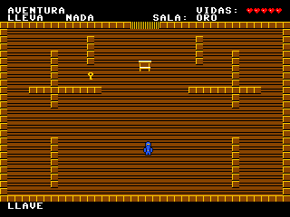
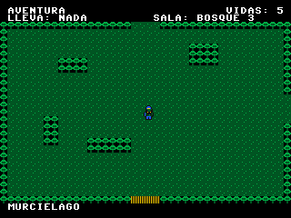

# AVENTURA

Homenaje al clasico **Adventure** de Atari 2600 para el core de video de
FPGA 6502 (`vc`). Programado en C con **cc65** y pensado para cargarse en el
monitor desde `$0800`.

> **Dependencia de `GRAF.DAT`:** el binario **no** lleva los graficos dentro: al
> arrancar carga los patrones de tiles y sprites desde **`GRAF.DAT`** en la SD.
> El fichero esta incluido en el repositorio (`assets/GRAF.DAT`, 1024 bytes) y
> hay que copiarlo a la SD junto al binario. Si falta, el juego muestra
> `FALTA GRAF.DAT / COPIALO EN LA SD` y se detiene.



## Objetivo

Recupera el **caliz** de la camara sellada del **Castillo Negro** y llevalo al
**pedestal de oro** del **Castillo de Oro** (habitacion inicial). Tienes 3
vidas.

## Controles

| Boton       | Accion                                  |
|-------------|-----------------------------------------|
| Joystick    | Mover al aventurero                     |
| Fuego       | Coger / soltar el objeto que este cerca |
| Fuego (victoria/derrota) | Reintentar                  |

El juego arranca directamente en el Castillo de Oro (sin pantalla de titulo).

Solo se puede llevar **un objeto a la vez**. Las llaves se consumen solas al
tocar su puerta correspondiente: las puertas se abren para siempre.

## Como jugar (progresion recomendada)

1. **Castillo de Oro**: coge la **llave amarilla** y abre la puerta norte.
2. En el bosque baja por el **agujero** de la sala *Entrada* para ir a las
   catacumbas, pero antes recoge la **espada** (Bosque 5) y el **puente**
   (Bosque 6).
3. **Catacumbas**:
   - Coge el **iman** (Catac. 2).
   - Coloca el **puente** sobre la pared central de Catac. 3 para cruzar.
   - Recoge la **llave blanca** (Catac. 4).
4. Vuelve al bosque. En *Bosque 4* la **llave blanca** abre la puerta norte
   del **Castillo Blanco**; dentro esta la **llave negra** (cuidado con el
   dragon amarillo: la espada los mata).
5. En la sala del **Foso**, coloca el **puente** sobre el agua. La **llave
   negra** abre la puerta norte del **Castillo Negro**.
6. Con el **iman**, atrae el caliz a traves del muro de la camara sellada.
   Cuando lo tengas cerca, pulsa fuego para cambiar el iman por el caliz.
7. Lleva el **caliz** al pedestal del Castillo de Oro y gana.

## Mapa de habitaciones

Rejilla del mundo exterior (indice = fila * 4 + columna):

```
+------------+------------+------------+------------+
| 0 BOSQUE 1 | 1 BOSQUE 2 | 2 CAST.NEGRO| 3 CAST.BLANCO
|  E,S       |  W,S       |  S (negra) |  S (blanca)
+------------+------------+------------+------------+
| 4 BOSQUE 3 | 5 ENTRADA  | 6 FOSO     | 7 BOSQUE 4
| N,E,S      | agujero    | N (negra)  | N (blanca)
| S (amarilla)            | agua       |
+------------+------------+------------+------------+
| 8 CAST.ORO | 9 BOSQUE 5 | 10 BOSQUE 6| 11 BOSQUE 7
| inicio     | espada     | puente     |            |
| N (amarilla)                          |
+------------+------------+------------+------------+
```

Catacumbas (se accede por el agujero de la sala 5):

```
12 CATAC.1 <-> 13 CATAC.2 <-> 14 CATAC.3 <-> 15 CATAC.4
 escaleras      iman           muro+puente     llave blanca
                dragon verde
```

Al subir por las escaleras de Catac. 1 vuelves a la sala *Entrada* (apareces
encima del agujero). Tanto al subir como al bajar suena un efecto de **pasos**:
tres golpes que ascienden al subir y descienden al bajar.

## Objetos y enemigos

- **Caliz**: camara sellada del Castillo Negro (se saca con el iman). Usa el
  diseno **con asas** (patron de sprite 0) y borde blanco para distinguirse.
- **Espada**: Bosque 5. Hoja blanca y empuñadura dorada. Mata dragones al
  tocarlos (tambien tirada en el suelo).
- **Puente**: Bosque 6. Se coloca sobre agua o sobre la pared de Catac. 3.
  Tiene **dos sprites**: vertical en el Foso (cruce arriba/abajo) y horizontal
  en Catac. 3 (cruce izquierda/derecha).
- **Iman**: Catac. 2. Herradura roja con polos blancos; atrae el caliz a traves
  de los muros con movimiento continuo (1 px por frame).
- **Llave amarilla**: Castillo de Oro. Abre la puerta norte de ese castillo.
- **Llave blanca**: Catac. 4. Abre la puerta del Castillo Blanco.
- **Llave negra**: Castillo Blanco. Abre la puerta del Castillo Negro.
- **Dragones**: rojo (Castillo Negro), verde (Catac. 2), amarillo (Castillo
  Blanco). Ahora **te persiguen** y, si huyes con uno cerca, **te sigue a la
  sala siguiente**. Matan al tocarte si no llevas la espada.
- **Murcielago**: Bosque 3. Ahora **te persigue**, te **roba el objeto** que
  lleves y **huye unos instantes** tras tocarte; **no quita vida**. El dragon
  sigue siendo el enemigo realmente peligroso.

Los dragones usan el diseño **Poison Drake** del pack, a 16x16, recoloreado en
rojo/verde/dorado y con **volteo horizontal** según la dirección en que vuelan:


## Compilar

Requiere [cc65](https://cc65.github.io/) en `D:/cc65` (o pasa `CC65_HOME`).

```sh
make CC65_HOME=D:/cc65
```

Genera:

- `output/aventura.bin` (13961 bytes, se carga en `$0800`)
- `output/aventura.map` (mapa de memoria)

`make` **no genera los graficos**: el binario usa `assets/GRAF.DAT` (1024 bytes:
64 registros de 16 bytes = 22 tiles de fondo + 42 sprites), que ya viene en el
repositorio y hay que copiar a la SD junto al binario.

## Cargar en el emulador

La SD debe contener **`AVENTURA.BI`** (el binario) y **`GRAF.DAT`** (los
patrones). Si aun no tienes la imagen de SD del emulador, creala de 16 MB y
copia los dos ficheros:

```sh
python D:/Proyectos/EmuladorFpga6502/tools/sd_tool.py format tarjeta.img 16
python D:/Proyectos/EmuladorFpga6502/tools/sd_tool.py inject tarjeta.img assets/GRAF.DAT GRAF.DAT
python D:/Proyectos/EmuladorFpga6502/tools/sd_tool.py inject tarjeta.img output/aventura.bin AVENTURA.BI
```

Con el monitor en marcha y la SD montada:

```
LOAD AVENTURA.BI 0800
R 0800
```

> MicroFS limita los nombres a 11 caracteres, por eso el fichero aparece como
> `AVENTURA.BI` (no `AVENTURA.BIN`).

Si falta `GRAF.DAT`, el juego muestra **`FALTA GRAF.DAT / COPIALO EN LA SD`** y
se detiene: sin patrones no hay graficos.

## Graficos (`GRAF.DAT`)

`assets/GRAF.DAT` es un fichero plano de 1024 bytes dividido en 64 registros de
16 bytes. Cada registro es un patron 8x8 con **dos planos** (8 B de plano 0 +
8 B de plano 1, color 0-3):

- registros 0-9: tiles de fondo base (suelo, hierba, agua, muro...);
- registros 10-13: **agujero**; 14-17: **escalera**; 18-21: **altar** (4 tiles
  16x16 cada uno);
- registros 22-63: **42 patrones de sprite** (jugador, dragones, objetos, caliz,
  corazon del HUD...).

El juego lo lee al arrancar con `rom_mfs_open` / `rom_mfs_read_via_zp` /
`rom_mfs_close`, en streaming de 16 bytes, y lo escribe en la VRAM con
`vc_load_bg_pattern` / `vc_load_spr_pattern`. Solo usa 16 bytes de buffer en
RAM, asi que los graficos no ocupan ni RODATA ni RAM.

Si cambias un diseno, vuelve a escribir `GRAF.DAT` y copialo a la SD:

```sh
python tools/gen_hud.py                    # corazon del HUD (sprite 41)
python tools/mock_hole.py --write-graf     # agujero (0x8A-0x8D) y escalera (0x8E-0x91)
python tools/mock_pedestal.py --write-graf # altar (0x92-0x95)
python tools/mock_chalice.py --write-graf  # caliz con asas (sprite 0)
```

### Editor grafico (GUI)

Para **extraer** y **anadir** patrones sin tocar el binario a mano hay una
aplicacion de escritorio (Tkinter, sin instalar nada mas que Pillow):

```sh
python tools/graf_editor.py            # abre assets/GRAF.DAT
python tools/graf_editor.py otro.dat   # o cualquier otro fichero
python tools/graf_editor.py assets/GRAF.DAT 36   # abre con un registro elegido
```

En Windows tambien se puede lanzar con doble clic en `tools/graf_editor.bat`.


- Miniaturas de los 64 registros (22 de fondo + 42 de sprites) con la **paleta
  real del juego**; se puede forzar otra paleta desde el desplegable.
- La **paleta cambia sola al seleccionar un patron**: es la que le pone el juego
  (hoyo en madera, escalera en gris, altar en oro, jugador en azul/oro, iman y
  dragon en rojo, corazon en rojo...). Los botones de color y la vista previa
  siguen esa paleta, y el desplegable permite forzar otra para ver como
  quedaria con otros colores.
- Pintar pixel a pixel el registro elegido: **clic izquierdo** pinta el color
  marcado y **clic derecho** pone el color 0 (transparente).
- Vista del **grupo de 4 registros** que forma cada imagen de 16x16 (hoyo,
  escalera, altar, jugador, dragones). Cada cuadrante (TL, TR, BL, BR) tiene su
  propio selector para **elegir que patron se pone en cada uno**, asi que se
  pueden componer imagenes 16x16 con patrones de cualquier parte del fichero:
  - al seleccionar un registro, el grupo se ajusta solo a la imagen a la que
    pertenece (por ejemplo, el registro 11 es la parte superior derecha del
    agujero);
  - clic en un cuadrante del mosaico: edita ese patron;
  - **Aplicar a 4 registros**: escribe los 4 patrones del grupo en los 4
    registros de la imagen (con confirmacion y deshacer);
  - **Exportar PNG (16x16)** exporta el mosaico tal y como se ve, con la paleta
    de cada patron.
- **Exportar PNG (8x8)** y **Exportar PNG (16x16)**: saca el patron como imagen
  con la paleta del juego.
- **Importar PNG (8x8)** y **Importar PNG (16x16)**: una imagen de 16x16 entra
  como 4 registros (TL, TR, BL, BR) y una de 8x8 como un registro. Los pixeles
  se ajustan al color mas cercano de la paleta.
- Volcado hexadecimal de los dos planos del registro, copiar, pegar y deshacer.
- Al guardar deja una copia `GRAF.DAT.bak` y avisa en la barra de estado.

La logica del formato esta separada en `tools/graf_format.py` (no depende de
Tkinter), por si se quiere usar desde la linea de ordenes:

```sh
python tools/graf_format.py assets/GRAF.DAT   # volcado de los 64 registros
```

## Detalles tecnicos

- Objetivo `none` de cc65, CPU 6502. Binario autocontenido cargado en `$0800`.
- Pantalla de texto 40x30. HUD en filas 1-2 y pista en la 28; juego en 3-27.
- El jugador y los dragones son objetos **16x16 (2x2 sprites)**. El jugador
  (caballero azul + oro) tiene 4 patrones por direccion y **2 fotogramas de
  caminar** para izquierda/derecha (24 patrones en total); los dragones usan el
  diseno **Poison Drake** con **2 fotogramas de aleteo** y la direccion
  izquierda se dibuja **espejada por codigo** (FLIP_X + intercambio de
  cuadrantes) para no duplicar patrones.
- El dibujo 16x16 (`draw16_fast`) escribe en cada frame solo X/Y/FLAGS de los 4
  cuadrantes; los TILES se reescriben solo cuando cambia el patron o el
  espejado. Antes cada cuadrante escribia tambien COLL y los tiles, y el
  dragon se quedaba fuera del VBLANK.
- IA de dragones: persiguen al jugador por ambos ejes (deslizan por las paredes)
  y, si huyes con uno a menos de 64 px, te sigue a la sala siguiente. Emiten
  gruñidos cuando estan cerca y un rugido al entrar contigo.
- Sprites: jugador en los slots OAM 12-15, dragones en 16-19, objetos en
  1-11 y el murcielago en el 20 (dibujado encima del jugador). Como maximo
  8 sprites por scanline; hay 32 en OAM.
- Para evitar parpadeos por la carrera con VBLANK, `draw_actors()` se llama
  justo despues de `vc_wait_vblank()` y antes de leer el joystick/actualizar el
  juego. El dragon se dibuja el primero, con `draw16_fast`, y sus slots no se
  apagan antes si esta presente; asi sus 4 sprites se escriben dentro del
  VBLANK. El jugador no parpadea (la invulnerabilidad no lo oculta).
- La celda donde esta el jugador siempre es transitable: si recoges el puente
  estando encima, puedes salir de la pared. Al soltarlo cerca de su sitio, se
  repone en la pared en vez de caer al lado.
- **Los patrones de sprites y tiles ya no viven en el binario**: se cargan al
  arrancar desde `GRAF.DAT` (SD) con la ROM API (`rom_mfs_open` /
  `rom_mfs_read_via_zp` / `rom_mfs_close`), en streaming de 16 bytes, y se
  escriben directamente en la VRAM con `vc_load_spr_pattern` /
  `vc_load_bg_pattern`. Solo se usa un buffer de 16 bytes en RAM; el binario
  queda en **13.961 bytes**.
- El **agujero** de la sala 5, la **escalera** de Catacumbas 1 y el **altar**
  del caliz son imagenes de **16x16 formadas por 4 tiles de fondo** cada una
  (no un tile repetido):
  - agujero: marco de madera y escalera de mano (paleta 1, `0x8A-0x8D`);
  - escalera: piedra gris (paleta 3, `0x8E-0x91`);
  - altar: mesa de patas en perfil (paleta 1, `0x92-0x95`), con el patron del
    suelo del castillo como fondo para que no quede dentro de un cuadrado.
  Las hojas de diseno estan en `doc/hole_options.png` y
  `doc/pedestal_options.png`.
- HUD: las vidas se muestran como **corazones** (sprite 41, paleta 2, uno por
  vida en los slots OAM 21-25) y al lado de `LLEVA` aparece el **icono del
  objeto** que llevas (slot 26). Ambos se redibujan cuando cambia el HUD, sin
  tocar la RAM del juego.
- No hay pantalla de titulo (se recorto para liberar RAM); el juego arranca
  directamente en el Castillo de Oro.
- El HUD usa nombres de sala cortos (B1, C2, ORO...) y pistas de una palabra
  para ahorrar RAM.
- Los tiles de fondo personalizados viven fuera de `$20-$7F`.
- VRAM y OAM se escriben en VBLANK a traves de `lib/vc.lib`.
- Colision por software con un unico punto central `(x+4, y+4)` contra la
  rejilla de celdas; asi se puede cruzar el puente de forma fiable.
- Sonido SID no bloqueante (`sound.c`): recoger/soltar, llave, gruñido, rugido,
  muerte, victoria y **pasos al subir/bajar las escaleras** (tres golpes de
  pulso que ascienden al subir y descienden al bajar). El ancho de pulso se
  fija a ~50% (si es 0, el pulso no suena en el SID).
- Para que todo quepa en RAM se enlaza contra la **libreria modular** de
  `videocore-6502-cc65` (`video.o`, `gfx_vram.o`, `gfx_tiles.o`, `gfx_text.o`,
  `gfx_pal.o`). Al no usar `vc_sprite_disable` (se apaga el sprite escribiendo
  OAM directamente) se descartan `gfx.o` y `collide.o`, ahorrando ~400 bytes.

- Las islas verdes del bosque usan el tile de fondo `0x81` rediseñado como
  **árbol** (copa verde, sombra y tronco). Al ser tile de fondo no consume OAM
  ni patrones de sprite extra; también decora el borde del bosque.



Mapa de memoria final:

| Segmento | Inicio | Fin    |
|----------|--------|--------|
| ZEROPAGE | `$0020`| `$0065`|
| CODE     | `$0847`| `$3AE6`|
| RODATA   | `$3AE7`| `$3E88`|
| BSS      | `$3E89`| `$3F07`|

Termina en `$3F07`, dejando unos **119 bytes libres** en la zona RAM del
programa (la pila de cc65 tiene ademas sus 256 bytes en `$3F7F-$3FFF`).

## Herramienta de pruebas

`tools/emu_play.py` ayuda a probar en el emulador de forma sincronizada
(posiciona el jugador por coordenadas en vez de por tiempo, porque la tasa de
frames del emulador varia):

```sh
python tools/emu_play.py state                 # estado actual
python tools/emu_play.py obj                   # posicion de los objetos
python tools/emu_play.py walk left 96          # moverse hasta px <= 96
python tools/emu_play.py seq "walk:up:72;tap:fire:140"
```

`tools/gen_player_A.py` genera el caballero A en 4 direcciones (azul + oro), y
`tools/gen_poison_drake.py` extrae el Poison Drake del pack y genera sus
patrones (1 frame + 2 direcciones):

```sh
python tools/gen_player_A.py preview     # doc/player_A_game.png
python tools/gen_player_A.py c           # patrones para game.c
python tools/gen_poison_drake.py c       # patrones + doc/poison_drake_ingame.png
```

`tools/dragon_pack_sheet.py` y `tools/dragon_pack_quant.py` generan las hojas
comparativas del Basic Asset Pack.
